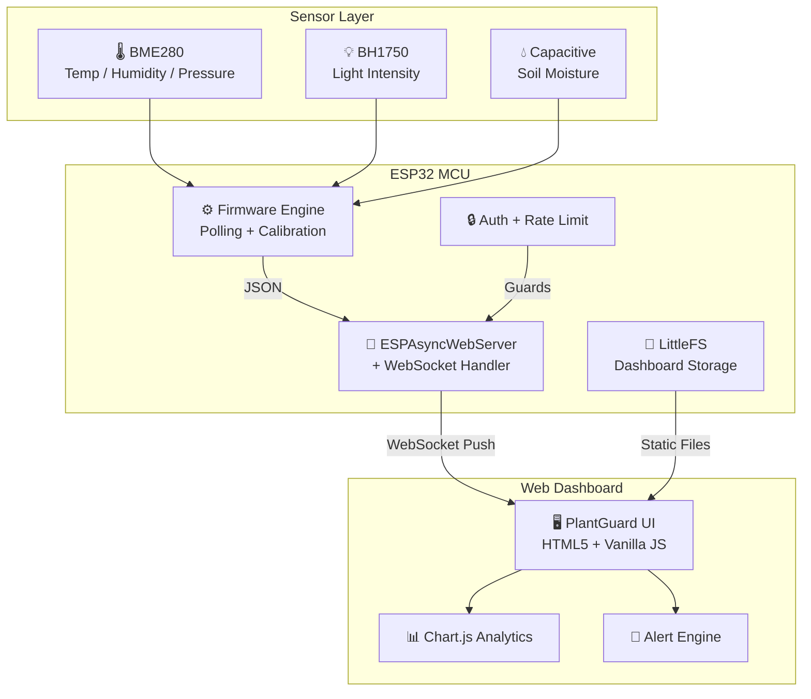

# 🌿 PlantGuard IoT — Smart Plant Monitoring System

An automated IoT system that monitors soil moisture, ambient light, temperature, and humidity in real-time. The ESP32 microcontroller reads sensor data and streams it via WebSockets to a premium cyberpunk-themed web dashboard, complete with animated telemetry rings, health scoring, alert engine, and Chart.js analytics.


---

## ⚡ Core Features

- **📡 Real-Time WebSocket Telemetry** — Sensor data pushed to dashboard every 2 seconds with <10ms latency
- **🌡️ Multi-Sensor Monitoring** — Soil moisture (capacitive), temperature, humidity, barometric pressure (BME280), and light intensity (BH1750)
- **🌱 Plant Health Scoring** — Weighted algorithm evaluating all sensor inputs to compute a 0-100 health score with EXCELLENT/GOOD/FAIR/POOR ratings
- **🔔 Intelligent Alert Engine** — Threshold-based alerting for drought, overwatering, temperature extremes, low light, and high humidity
- **📊 Telemetry Trends Chart** — Chart.js line graph with rolling 24-hour history and toggleable datasets
- **🖥️ Premium Dark Dashboard** — Glassmorphic UI with animated SVG rings, cyber-themed design, and responsive layout
- **🔒 Cybersecurity Hardened** — HTTP Basic Auth, WebSocket rate limiting, origin validation, input sanitization, security headers, XSS prevention
- **🎮 Browser Simulation Mode** — Full demo without hardware — realistic sensor simulation with day/night cycles, watering events, and time acceleration

---

## 🏗️ Architecture



---

## 📂 Project Structure

```
iot-plant-monitor/
├── index.html              # Dashboard UI (simulator version — Vercel deployed)
├── style.css               # Cyberpunk dark theme + glassmorphism
├── app.js                  # Dashboard logic: Chart.js, alerts, animations
├── simulator.js            # Synthetic sensor engine (day/night cycles)
├── vercel.json             # Deployment config with security headers
│
├── firmware/               # ESP32 PlatformIO project (hardware version)
│   ├── platformio.ini      # Board config + library dependencies
│   ├── src/main.cpp        # Firmware: WiFi, WebSocket, sensor polling
│   └── include/
│       ├── config.h        # WiFi creds, pins, thresholds (.gitignored)
│       └── sensors.h       # Sensor abstraction + health scoring
│
├── wokwi/                  # Virtual circuit simulation
│   ├── diagram.json        # Wokwi circuit layout
│   └── sketch.ino          # Simplified simulation firmware
│
├── README.md
├── LICENSE
└── .gitignore
```

---

## 🚀 Quick Start

### Live Demo (No Hardware Required)
Visit the deployed dashboard: **[PlantGuard IoT Demo](#)** ← *(Add your Vercel URL)*

Click **Start** to begin the simulation. Use the speed controls to accelerate time and watch the full day/night cycle with automatic alerts and watering events.

### Run Locally
```bash
# Clone the repository
git clone https://github.com/YOUR_USERNAME/iot-plant-monitor.git
cd iot-plant-monitor

# Open index.html in your browser — no server needed!
start index.html
```

### Flash to ESP32 (Hardware)
```bash
# Requires PlatformIO CLI
cd firmware

# 1. Copy and configure credentials
cp include/config.h.example include/config.h
# Edit config.h with your WiFi SSID/password

# 2. Build and upload firmware
pio run -t upload

# 3. Upload dashboard to LittleFS
pio run -t uploadfs

# 4. Open Serial Monitor for IP address
pio device monitor
```

---

## 🔒 Security Features

| Feature | Implementation | Purpose |
|---|---|---|
| HTTP Basic Auth | ESPAsyncWebServer middleware | Prevent unauthorized dashboard access |
| WebSocket Rate Limiting | Max 5 concurrent clients | Prevent resource exhaustion (DoS) |
| Origin Validation | WebSocket handshake check | Block cross-origin hijacking |
| Input Sanitization | JSON validation + size limits | Prevent injection attacks |
| Security Headers | X-Frame-Options, CSP, HSTS | Prevent clickjacking and XSS |
| Credential Isolation | `config.h` in `.gitignore` | Prevent secret leakage to GitHub |
| XSS Prevention | `textContent` over `innerHTML` | Prevent reflected XSS in dashboard |

---

## 🌱 Plant Health Algorithm

```
Health Score = Weighted Average of:
  ├── Soil Moisture (40%) → Optimal: 35-65%
  ├── Temperature   (25%) → Optimal: 18-28°C
  ├── Humidity      (15%) → Optimal: 40-70%
  └── Light Level   (20%) → Optimal: 300-900 lux

Rating Scale:
  ≥80 → EXCELLENT  |  ≥60 → GOOD  |  ≥40 → FAIR  |  <40 → POOR
```

---

## 🛠️ Tech Stack

| Layer | Technology | Purpose |
|---|---|---|
| Microcontroller | ESP32-DevKitC | WiFi-enabled MCU |
| Firmware | C++ / Arduino | Sensor polling + WebSocket server |
| Build System | PlatformIO | Dependency management + flashing |
| Sensors | BME280, BH1750, Capacitive | Environmental monitoring |
| Communication | WebSockets (ESPAsyncWebServer) | Real-time bidirectional data |
| Storage | LittleFS | On-chip dashboard hosting |
| Frontend | HTML5 + Vanilla JS + CSS | Dashboard interface |
| Charts | Chart.js 4.x | Telemetry trend visualization |
| Simulation | Custom JS Engine | Realistic synthetic data |
| Deployment | Vercel | Static site hosting |

---

## 📄 License

This project is build with ☕ & ❤️ by Rizwan Khan